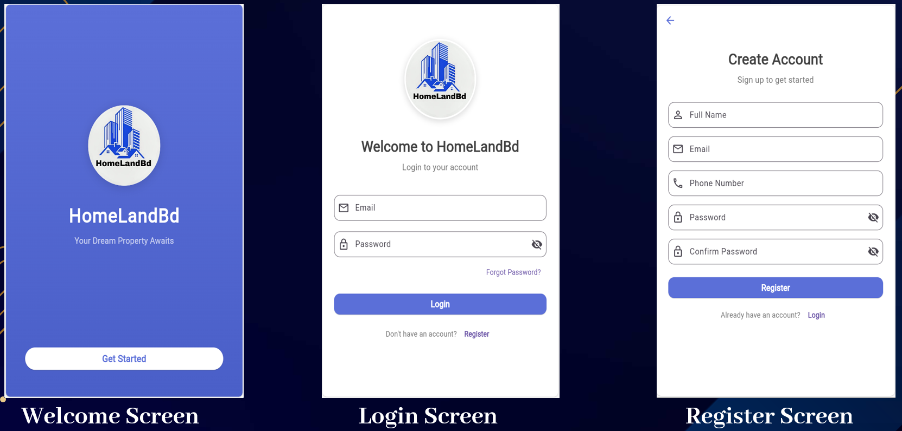

# HomeLandBd-Mobile-App

# 🏢 HomeLandBd — Real Estate & Property Management Mobile App

**HomeLandBd** ("Your Dream Property Awaits") is a comprehensive real estate and property management mobile application designed to connect property buyers, sellers, developers, and investors on a single unified platform. 

This project was designed and developed as part of the **Mobile Application Design Lab** coursework.

---

## 👨‍💻 Project Contributors (Team)

* **1. Imran Munshi** — **ID:** `222-15-6376`
* **2. Md. Zamirul Islam Reyad** — **ID:** `222-15-6224`

---

## 📱 Application Screenshots

### 1. Onboarding & User Authentication
*(Welcome Screen, Login Screen, and Register Screen)*

### 2. Core Navigation & Property Browsing
*(Home Dashboard, Side Navigation Drawer, Buy Property Categories, and Apartment List)*

### 3. Property Listing, Development & Investment Portals
*(Sell Property Form, Ongoing Development Projects, and Investment Opportunities)*

### 4. Comprehensive Property & Project Details
*(Apartment Details, Development Details, and Investment Details)*

---

## ✨ Detailed App Features & Screen Breakdown

| Screen / Module | Complete Feature Description |
| :--- | :--- |
| **1. Welcome Screen** | Displays the official **HomeLandBd** branding, custom architectural logo, tagline (*"Your Dream Property Awaits"*), and a quick-action **Get Started** button for smooth user onboarding. |
| **2. Login Screen** | Secure authentication portal featuring Email and Password input fields, a password visibility toggle, a **Forgot Password?** recovery option, and a direct navigation link to register a new account. |
| **3. Register Screen** | Complete user registration form with structured input fields for **Full Name**, **Email**, **Phone Number**, **Password**, and **Confirm Password** to onboard new buyers, sellers, and investors. |
| **4. Home Dashboard** | Central hub featuring a top search bar, chat & notification alerts, quick-access module pills (**Buy**, **Sell**, **Dev.**, **Inv.**), and categorized horizontal carousels for **Apartments For Sale** (with sqft metrics), **Lands For Sale**, and **Ongoing Projects**, paired with a 4-tab bottom navigation bar. |
| **5. Side Navigation Drawer** | Slide-out user profile menu displaying the logged-in user's avatar, name, and email, with direct routing to **Home**, **Buy Property**, **Sell Property**, **Development**, **Investment**, **My Favorites**, **My Listings**, **Profile**, **Settings**, **About**, and **Help & Support**. |
| **6. Buy Property & Apartment List** | Categorized property discovery module allowing users to filter listings by **Apartments**, **Land**, and **Buildings**. Includes a dedicated search filter and detailed listing cards (e.g., *Podda Building in Dhanmondi*, *Bani Villa in Mirpur*). |
| **7. Sell Property Screen** | Interactive property submission form enabling owners to list properties by selecting a **Property Type** dropdown (e.g., Apartment), entering **Property Title**, **Price (BDT)**, **Area (sqft)**, **Location**, **Description**, and uploading photos via the **Add Images** picker. |
| **8. Development Screen** | Dedicated construction tracker with a developer/project search bar and visual cards for **Ongoing Projects** displaying real-time completion badges (e.g., *45% Complete*, *35% Complete*). |
| **9. Investment Screen** | Curated portal for high-yield real estate investments (such as *Bay Hills* and *Bay Breeze*), equipped with a dedicated search bar for exploring commercial and hospitality ventures. |
| **10. Apartment, Development & Investment Details** | Rich specification views featuring high-resolution property headers, pricing statuses (*Call For Price*), one-tap contact actions (**Email**, **Call**, **Location**), project summaries, owner details, and bulleted amenities (bedrooms, baths, 24/7 generator, gas supply, lift, swimming pool, spa, and build year). |

---

## 🛠️ Technology Stack & Tools
* **Framework:** Flutter
* **Programming Language:** Dart
* **UI/UX Design:** Material Design Components, Custom Responsive Layouts
* **Course:** Mobile Application Design Lab

---

## 📂 Repository Contents
* `hlandbdd.zip` — Complete project archive from local development environment.
* `*.png / *.jpg` — High-resolution UI screen captures of all application modules.
